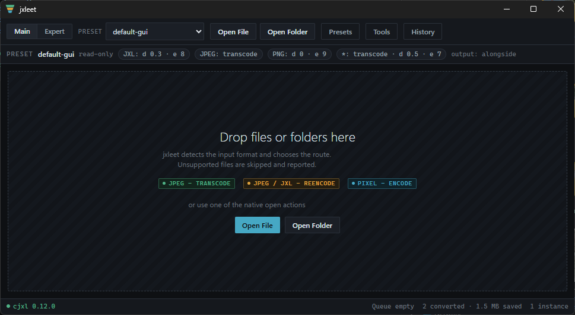

**This repository is deleted.** jxl for lightroom was only ever a proof of concept and is no longer maintained.

👉 The successor project is **[jxleet](https://github.com/dhcgn/jxleet/)**.

## About jxleet

JPEG-XL-Expert-Encoding-Tool — a comfortable way to use `cjxl` on Windows. It exposes the full `cjxl` flag surface through a GUI, an Explorer context menu, and the command line, with preset-based batch conversion, a managed libjxl toolchain, and Lightroom integration.

*Screenshot from a very early state of jxleet — the app has evolved since.*

---

# jxl for lightroom
Create JpegXl files from Lightroom with user export

> This project is a proof of concept for a user export plugin for Lightroom.

## Demo

## Motivation

I want to extend the popularity of the [JpegXl](https://jpegxl.com/) format, hopefully this format will be soon supported by OpenSource Community, Google, Apple and Microsoft.

A Lightroom Plugin would be a better way to create JpegXl files out of Lightroom. But I currently have no resources to learn Lua. But this tool works fine and can be integrated into Lightroom.

## What is Missing?

A Lot, feel free to contribute! Or add issues.

See: https://github.com/dhcgn/jxl-for-lightroom/issues

## Install

> Currently only works on Windows

Just copy the file `jxl-for-lightroom.exe` (see [Releases](https://github.com/dhcgn/jxl-for-lightroom/releases) and assets) to some location and add this location to your export profile.

I prefer: `C:\Users\MyUserName\AppData\Roaming\Adobe\Lightroom\Modules\jxl-for-lightroom\jxl-for-lightroom.exe`

1. Go to `File->Exports...`
2. Create a new Preset with these settings:
   1. `File Settings` to `PNG` (`JPEG` works too)
   2. `Post-Processing` 
      1. `After Export` set to `Open in Other Application...`
      2. `Application` set to the file `jxl-for-lightroom.exe`
3. Save the preset

## How does it work?

This project includes the executable from the project https://github.com/libjxl/libjxl, which will be extracted at program start.
Lightroom call this tool with all files to convert, then a webpage is opened in the standard browser.
On the webpage you can select parameters for the encoding to jpegxl and start the encoding.

